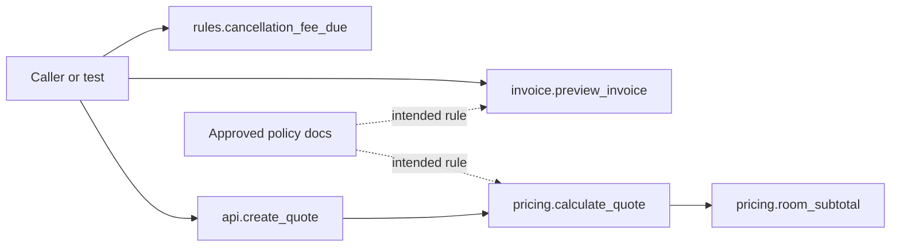

# Architecture overview

Scope: the repository root and `starter/booking_platform` as inspected statically. **Verified** means visible in source, tests, or the approved rule sheets; **unknown** means the repository does not establish it. See [unknowns](08-uncknowns-and-validations.md).

## Repository inventory and analysis plan

| Phase | Scope | Evidence/result |
|---|---|---|
| 1. Inventory | Root and application tree | Python-only application under `starter/booking_platform`; `src` has four nonempty modules, `tests` has four test modules ([app README](../../starter/booking_platform/README.md#L1-L9), [source entry](../../starter/booking_platform/src/api.py#L1-L7)). |
| 2. Contracts | Public functions, inputs, outputs | [Function inventory](03-function-inventory.md), [data contracts](05-api-and-data-contracts.md). |
| 3. Dependencies | Imports, calls, libraries | [Dependency map](02-module-dependency.md), [call graph](04-function-call-graph.md). |
| 4. Execution | Quote, invoice, empty-input, cancellation paths | [Execution flows](06-execution-flow.md). |
| 5. Impact | Drift, coupling, tests | [Change impact](07-change-impact-analysis.md). |

## Language, framework, pattern

| Finding | Status | Evidence |
|---|---|---|
| Python application and `unittest` tests | Verified | `.py` files and `import unittest` in [test_quote.py:1](../../starter/booking_platform/tests/test_quote.py#L1). |
| No installed web framework, route decorator, server startup, or HTTP listener appears in the inspected tree | Verified absence in repository; deployment unknown | [`api.py:1-7`](../../starter/booking_platform/src/api.py#L1-L7) calls itself “HTTP-facing” but contains an ordinary function. |
| Functional, small-module organization: entry/orchestration (`api`), calculations (`pricing`, `invoice`), and policy helper (`rules`) | Verified source structure; “layered” is a descriptive interpretation | [`api.py:2-7`](../../starter/booking_platform/src/api.py#L2-L7), [`pricing.py:3-15`](../../starter/booking_platform/src/pricing.py#L3-L15), [`invoice.py:3-7`](../../starter/booking_platform/src/invoice.py#L3-L7), [`rules.py:2-6`](../../starter/booking_platform/src/rules.py#L2-L6). |
| Database, external APIs, background jobs, and service processes | No implementation found in inspected repository; runtime deployment unknown | Source modules have no database/network imports or job definitions ([dependency map](02-module-dependency.md)). |

## Major directories

| Path | Responsibility | Evidence |
|---|---|---|
| `starter/booking_platform/src/` | Importable application functions | [`api.py`](../../starter/booking_platform/src/api.py#L1), [`pricing.py`](../../starter/booking_platform/src/pricing.py#L1), [`invoice.py`](../../starter/booking_platform/src/invoice.py#L1), [`rules.py`](../../starter/booking_platform/src/rules.py#L1). |
| `starter/booking_platform/tests/` | Unit and baseline contract examples | [`test_quote.py`](../../starter/booking_platform/tests/test_quote.py#L1), [`test_invoice.py`](../../starter/booking_platform/tests/test_invoice.py#L1), [`test_rules.py`](../../starter/booking_platform/tests/test_rules.py#L1), [`test_baseline_contracts.py`](../../starter/booking_platform/tests/test_baseline_contracts.py#L1). |
| `starter/booking_platform/policy/` | Local approved training rule sheet | [business_rules.md:1-12](../../starter/booking_platform/policy/business_rules.md#L1-L12). |
| Root `policy/` | Expanded approved rule sheet, including interpretation and cancellation timing | [business_rules.md:1-20](../../policy/business_rules.md#L1-L20). |
| `worksheets/` | Learner evidence/review templates | [reconnaissance.md:1-22](../../worksheets/reconnaissance.md#L1-L22). |
| `review_packet/` | Instructor challenge/regression notes; not application code | [intentional_regression.md:1-7](../../review_packet/intentional_regression.md#L1-L7). |
| Root brief/readmes/walkthrough | Exercise scope and guidance | [brief.md:1-25](../../brief.md#L1-L25), [walkthrough.md:1-45](../../walkthrough.md#L1-L45). |

## Entry points and configuration

`src.api.create_quote(rooms)` and `src.invoice.preview_invoice(rooms)` are the documented public functions ([README:9](../../starter/booking_platform/README.md#L9)). Tests also directly call `src.rules.cancellation_fee_due` ([test_rules.py:2-7](../../starter/booking_platform/tests/test_rules.py#L2-L7)). `src.pricing.cancellation_fee` is defined but has no in-repository caller. No CLI `main`, route registration, scheduler, configuration file, dependency manifest, or environment-variable read was found in the inspected repository. The test invocation is documented in [README:3-7](../../starter/booking_platform/README.md#L3-L7), but tests were not run for this static analysis.

