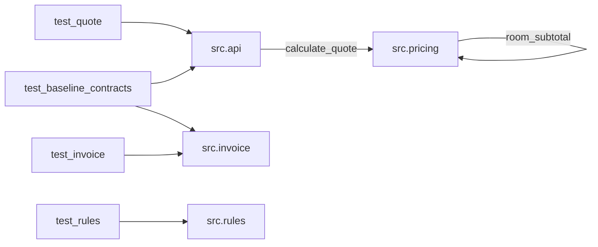

# Module dependency map

This map includes source imports and direct function calls visible in the repository. An arrow means “imports/calls,” not a runtime deployment connection. See [function-level graph](04-function-call-graph.md).

| Module | Direct application dependency | Function edge | Evidence |
|---|---|---|---|
| `src.api` | `src.pricing` | `create_quote → calculate_quote` | [`api.py:2-7`](../../starter/booking_platform/src/api.py#L2-L7) |
| `src.pricing` | None | `calculate_quote → room_subtotal` | [`pricing.py:3-9`](../../starter/booking_platform/src/pricing.py#L3-L9) |
| `src.invoice` | None | None; calculation is inline | [`invoice.py:3-7`](../../starter/booking_platform/src/invoice.py#L3-L7) |
| `src.rules` | None | None | [`rules.py:2-6`](../../starter/booking_platform/src/rules.py#L2-L6) |
| `tests.test_quote`, `tests.test_baseline_contracts` | `src.api` | test methods → `create_quote` | [`test_quote.py:1-10`](../../starter/booking_platform/tests/test_quote.py#L1-L10), [`test_baseline_contracts.py:1-10`](../../starter/booking_platform/tests/test_baseline_contracts.py#L1-L10) |
| `tests.test_invoice`, `tests.test_baseline_contracts` | `src.invoice` | test methods → `preview_invoice` | [`test_invoice.py:1-8`](../../starter/booking_platform/tests/test_invoice.py#L1-L8), [`test_baseline_contracts.py:1-10`](../../starter/booking_platform/tests/test_baseline_contracts.py#L1-L10) |
| `tests.test_rules` | `src.rules` | test method → `cancellation_fee_due` | [`test_rules.py:1-7`](../../starter/booking_platform/tests/test_rules.py#L1-L7) |

## Third-party and infrastructure dependencies

| Area | Verified finding | Limit |
|---|---|---|
| Third-party libraries/versions | No third-party imports or dependency manifest found in the repository. Application uses Python built-ins `sum` and `round`; tests import standard-library `unittest` ([pricing.py:3-9](../../starter/booking_platform/src/pricing.py#L3-L9), [test_quote.py:1](../../starter/booking_platform/tests/test_quote.py#L1)). | Python interpreter version and installed packages are unknown. |
| API → service → database | Only local `api.create_quote → pricing.calculate_quote → room_subtotal` exists ([api.py:2-7](../../starter/booking_platform/src/api.py#L2-L7), [pricing.py:3-9](../../starter/booking_platform/src/pricing.py#L3-L9)). | No database adapter, connection, repository, network client, or actual HTTP route appears in source. |
| Background workers | None found in application source. | External scheduling cannot be established from this repository. |
| Circular imports | None among application modules. | Based on inspected imports only. |
| Coupling | `api` indexes the three pricing result keys directly; quote and invoice duplicate response construction and subtotal logic ([api.py:6-7](../../starter/booking_platform/src/api.py#L6-L7), [invoice.py:4-7](../../starter/booking_platform/src/invoice.py#L4-L7)). | Runtime consumers outside repository are unknown. |
