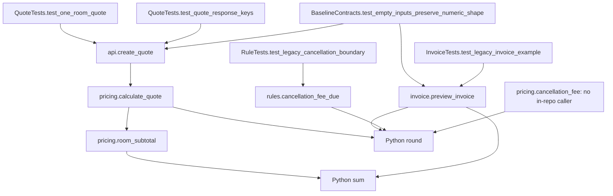

# Function call graph

Edges are direct calls visible in source/tests, not guessed production call paths. See [module map](02-module-dependency.md) and [flows](06-execution-flow.md).

| Caller | Callee | Arguments passed | Evidence |
|---|---|---|---|
| `api.create_quote` | `pricing.calculate_quote` | The same `rooms` object | [`api.py:4-6`](../../starter/booking_platform/src/api.py#L4-L6) |
| `pricing.calculate_quote` | `pricing.room_subtotal` | The same `rooms` object | [`pricing.py:6-7`](../../starter/booking_platform/src/pricing.py#L6-L7) |
| `pricing.room_subtotal` | `sum` | Generator of `nightly_rate * nights * rooms.get(..., 1)` | [`pricing.py:3-4`](../../starter/booking_platform/src/pricing.py#L3-L4) |
| `pricing.calculate_quote` | `round` | `subtotal * 0.10` | [`pricing.py:8`](../../starter/booking_platform/src/pricing.py#L8) |
| `invoice.preview_invoice` | `sum` (twice), `round` | First sum of line amounts; second sum of line amounts times `0.12`, then round | [`invoice.py:3-7`](../../starter/booking_platform/src/invoice.py#L3-L7) |
| Both cancellation helpers | `round` below 24 hours | `booking_total * 0.50` | [`pricing.py:11-15`](../../starter/booking_platform/src/pricing.py#L11-L15), [`rules.py:2-6`](../../starter/booking_platform/src/rules.py#L2-L6) |

Tests call the production functions with the fixtures shown in [function inventory](03-function-inventory.md#test-methods-as-callers). `pricing.cancellation_fee` has no caller in the inspected repository; this does not prove no external consumer exists.
