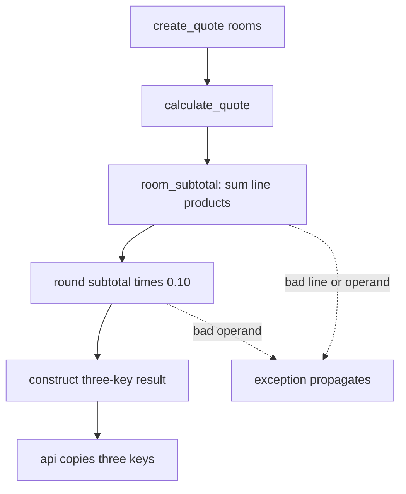
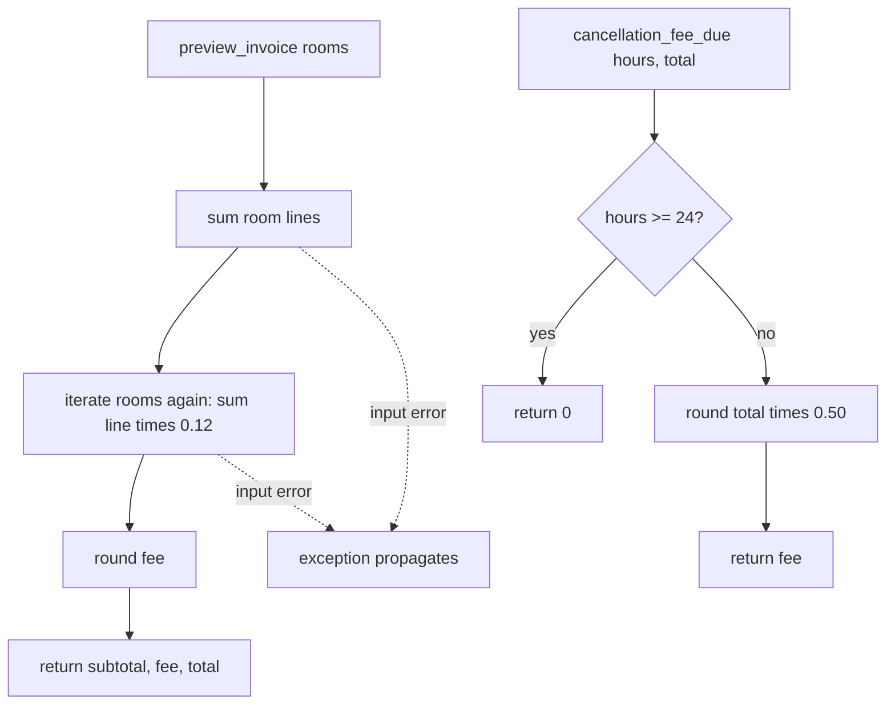

# Execution flow

These are the five most relevant **in-repository invocation scenarios**. Quote/invoice are documented public functions, but no actual route or background trigger exists in source ([README:9](../../starter/booking_platform/README.md#L9), [api.py:1-7](../../starter/booking_platform/src/api.py#L1-L7)). Test calls are known triggers; production callers remain unknown.

| Flow | Trigger / sequence and arguments | Transformations, interaction, output/error path |
|---|---|---|
| 1. Nonempty quote | `test_one_room_quote` calls `create_quote([{nightly_rate:100,nights:2}])` → `calculate_quote(rooms)` → `room_subtotal(rooms)` ([test_quote.py:5-7](../../starter/booking_platform/tests/test_quote.py#L5-L7), [api.py:4-7](../../starter/booking_platform/src/api.py#L4-L7), [pricing.py:3-9](../../starter/booking_platform/src/pricing.py#L3-L9)). | Line = `100*2*1=200`; fee = `round(200*.10)=20`; total 220; dictionary returned. Invalid line/operands propagate exceptions. No DB/API interaction. |
| 2. Nonempty invoice | `test_legacy_invoice_example` calls `preview_invoice` with same line ([test_invoice.py:5-8](../../starter/booking_platform/tests/test_invoice.py#L5-L8), [invoice.py:3-7](../../starter/booking_platform/src/invoice.py#L3-L7)). | First pass subtotal 200; second pass `round(200*.12)=24`; total 224. No DB/API interaction. Missing keys/type errors propagate; one-shot iterable is consumed on first pass. |
| 3. Empty quote | `test_quote_response_keys` and `test_empty_inputs_preserve_numeric_shape` call `create_quote([])` ([test_quote.py:9-10](../../starter/booking_platform/tests/test_quote.py#L9-L10), [test_baseline_contracts.py:6-10](../../starter/booking_platform/tests/test_baseline_contracts.py#L6-L10)). | `sum(empty)=0`, `round(0)=0`; returns three zero-valued fields via pricing and api. No external interaction. |
| 4. Empty invoice | `test_empty_inputs_preserve_numeric_shape` calls `preview_invoice([])` ([test_baseline_contracts.py:6-10](../../starter/booking_platform/tests/test_baseline_contracts.py#L6-L10)). | Both sums zero; fee zero; returns same three fields. No external interaction. |
| 5. Cancellation helper | `test_legacy_cancellation_boundary` calls `cancellation_fee_due(24,200)` and `(23,200)` ([test_rules.py:5-7](../../starter/booking_platform/tests/test_rules.py#L5-L7)). | 24 → 0; 23 → `round(200*.50)=100` ([rules.py:2-6](../../starter/booking_platform/src/rules.py#L2-L6)). `pricing.cancellation_fee` has the same code but no in-repo caller ([pricing.py:11-15](../../starter/booking_platform/src/pricing.py#L11-L15)). Both conflict with 48-hour approved policy. No external interaction. |

## Quote and invoice sequence

```mermaid
sequenceDiagram
  actor Caller
  participant API as api.create_quote
  participant Price as pricing.calculate_quote
  participant Sub as pricing.room_subtotal
  participant Inv as invoice.preview_invoice
  Caller->>API: rooms
  API->>Price: rooms
  Price->>Sub: rooms
  Sub-->>Price: subtotal
  Price->>Price: round(subtotal * 0.10)
  Price-->>API: subtotal, service_fee, total
  API-->>Caller: same three keys
  Caller->>Inv: rooms
  Inv->>Inv: sum lines; sum lines * 0.12; round
  Inv-->>Caller: subtotal, service_fee, total
```

## Quote control flow



## Invoice and cancellation control flow


