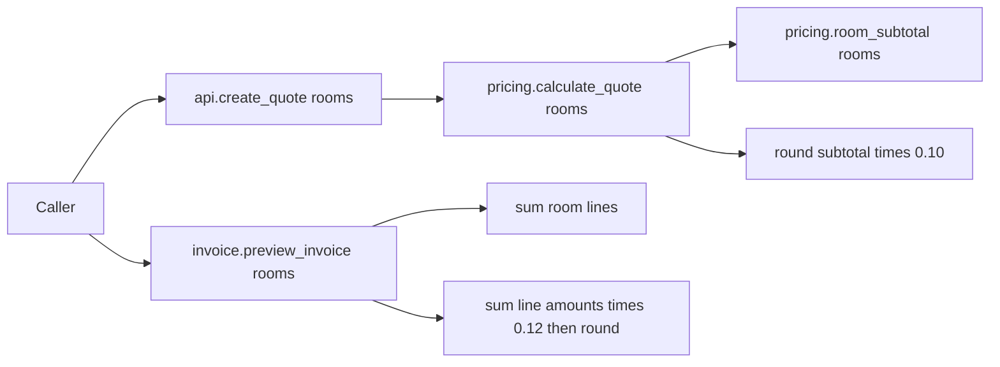
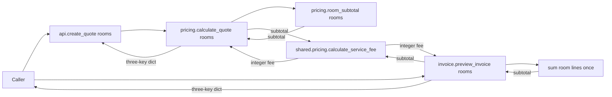

# Shared service-fee design

Status: **proposed for human review; no implementation authorized by this document**. This design covers [REQ-01–REQ-07](requirement.md#numbered-requirements). Source, tests, both approved policy sheets, and [AGENTS.md](../AGENTS.md#L3-L8) were checked directly. The approved calculation is 10% of the sum of room lines, rounded once with Python `round` ([root policy:7-12](../../../policy/business_rules.md#L7-L12), [local policy:5-9](../policy/business_rules.md#L5-L9)).

## Current calls and drift

`create_quote` delegates to `calculate_quote` and copies its three response fields ([api.py:2-7](../src/api.py#L2-L7)); `calculate_quote` calls `room_subtotal` before applying 10% ([pricing.py:3-9](../src/pricing.py#L3-L9)). `preview_invoice` separately computes the subtotal and a 12% fee, traversing `rooms` twice ([invoice.py:3-7](../src/invoice.py#L3-L7)). The approved policy requires one 10% rule for both paths ([root policy:7-10](../../../policy/business_rules.md#L7-L10)). The existing invoice test explicitly labels its `24` fee on subtotal `200` as historical ([test_invoice.py:5-8](../tests/test_invoice.py#L5-L8)).

## Proposed calls

The `api.create_quote(rooms)` body can remain unchanged: it already routes through `pricing.calculate_quote` ([api.py:4-7](../src/api.py#L4-L7)). `pricing.calculate_quote` will replace its inline fee expression with a call to the shared helper. `invoice.preview_invoice` will retain its current subtotal expression, replace its second traversal and 12% expression with a call to the helper, and retain its three-key return dictionary ([pricing.py:6-9](../src/pricing.py#L6-L9), [invoice.py:3-7](../src/invoice.py#L3-L7)). This is a **proposal**, not a relationship present in current code.

## Shared helper contract and calculation order

**Proposed signature:** `def calculate_service_fee(subtotal):` in `src/shared/pricing.py`, imported as `from src.shared.pricing import calculate_service_fee` by `src.pricing` and `src.invoice`. The helper takes one already-aggregated room subtotal and returns `round(subtotal * 0.10)`. It does not accept room lines, build a quote/invoice dictionary, or calculate a subtotal. There is no optional parameter, type conversion, or new validation. The proposed return is an `int` for the ordinary Python numeric inputs used by current tests; unsupported custom numeric types remain unspecified. This signature/location is a **design proposal requiring reviewer acceptance**, selected to make the aggregate-before-rounding boundary explicit. The policy mandates the formula and rounding point, but does not mandate a helper name or file ([root policy:7-10](../../../policy/business_rules.md#L7-L10); task asks for shared behavior in [brief:5-7](../../../brief.md#L5-L7)).

Order for each public path:

1. Form each line amount as `room["nightly_rate"] * room["nights"] * room.get("rooms", 1)` and sum to `subtotal` ([pricing.py:3-4](../src/pricing.py#L3-L4), [invoice.py:4](../src/invoice.py#L4), [root policy:8](../../../policy/business_rules.md#L8)).
2. Pass that one subtotal to `calculate_service_fee(subtotal)`; compute `round(subtotal * 0.10)` once ([root policy:7-10](../../../policy/business_rules.md#L7-L10)).
3. Return `{"subtotal": subtotal, "service_fee": fee, "total": subtotal + fee}`. The `api` wrapper continues copying the same keys from `calculate_quote` ([pricing.py:9](../src/pricing.py#L9), [invoice.py:7](../src/invoice.py#L7), [api.py:7](../src/api.py#L7), [root policy:11](../../../policy/business_rules.md#L11)).

For `[]`, `sum` yields `0`, so the shared helper yields `round(0 * 0.10) == 0`; both paths return `0/0/0`. This follows the source formulas and approved zero-subtotal rule ([pricing.py:3-9](../src/pricing.py#L3-L9), [invoice.py:3-7](../src/invoice.py#L3-L7), [root policy:12](../../../policy/business_rules.md#L12)).

### Subtotal placement and scope decision

**Proposal requiring reviewer acceptance:** keep `room_subtotal(rooms)` in `src.pricing` and the existing subtotal expression in `src.invoice`. Only fee calculation moves to `src/shared/pricing.py`. This leaves a small subtotal expression duplicated, but avoids changing the separate subtotal code while satisfying the brief's explicit service-fee scope ([brief:13-15](../../../brief.md#L13-L15), [pricing.py:3-9](../src/pricing.py#L3-L9), [invoice.py:3-7](../src/invoice.py#L3-L7)). Both subtotal expressions currently implement the same room-line formula and omitted `rooms` default ([pricing.py:4](../src/pricing.py#L4), [invoice.py:4](../src/invoice.py#L4)); the tests proposed below protect that behavior. A later shared subtotal helper would require separate scope review.

This design also makes invoice preview traverse `rooms` once instead of twice. The current second traversal can be empty for a one-shot iterator, producing a misleading fee ([invoice.py:4-6](../src/invoice.py#L4-L6)). One-shot iterator support is not an established public contract ([requirements:53-59](requirement.md#open-questions-for-review)). The reduced traversal is a direct consequence of replacing the second fee expression, and the reviewer should acknowledge it; the design does not add an iterator-support promise or new input validation.

## Compatibility and intentional behavior change

| Area | Current behavior | Proposed behavior / impact | Evidence |
|---|---|---|---|
| Quote public surface | `create_quote(rooms)` returns `subtotal`, `service_fee`, `total`. | Keep signature and keys unchanged. The approved 10% formula already matches quote's ordinary numeric cases. | [api.py:4-7](../src/api.py#L4-L7), [pricing.py:6-9](../src/pricing.py#L6-L9), [test_quote.py:5-10](../tests/test_quote.py#L5-L10) |
| Invoice public surface | `preview_invoice(rooms)` returns the same keys, using 12%. | Keep signature and keys; intentionally change fee from 12% to 10%, and therefore change `total` when the fee differs. | [invoice.py:3-7](../src/invoice.py#L3-L7), [root policy:7-11](../../../policy/business_rules.md#L7-L11) |
| Historical invoice assertion | Subtotal `200`, fee `24`, total `224`. | After refactor, update that assertion to subtotal `200`, fee `20`, total `220`; rename/reword the test so it no longer calls the approved result “legacy.” Record the old result as historical evidence in specs/review notes. | [test_invoice.py:5-8](../tests/test_invoice.py#L5-L8), [root policy:14-16](../../../policy/business_rules.md#L14-L16) |
| Errors | No `try/except`, schema validation, or type annotations. | Add none. Missing keys or incompatible operands continue to propagate native exceptions; exact type for arbitrary inputs is outside this contract. | [api.py:4-7](../src/api.py#L4-L7), [pricing.py:3-9](../src/pricing.py#L3-L9), [invoice.py:3-7](../src/invoice.py#L3-L7) |
| Numeric/rounding | Quote uses floating factor `0.10`; invoice uses `0.12`; both use Python `round`. | Keep Python arithmetic and `round` with no `ndigits`; do not introduce Decimal, per-line rounding, or a new currency convention. The invoice rate correction is the intentional change. | [pricing.py:8](../src/pricing.py#L8), [invoice.py:6](../src/invoice.py#L6), [root policy:10](../../../policy/business_rules.md#L10) |

## Test plan: observed behavior versus approved behavior

These are **proposed tests**, not tests already executed. Complete characterization before changing production code, then add policy acceptance tests and perform the focused refactor ([brief:19-24](../../../brief.md#L19-L24), [AGENTS.md:4-7](../AGENTS.md#L4-L7)).

| Stage | Proposed test/evidence | Expected meaning |
|---|---|---|
| Characterization before change | Keep the existing one-room quote assertion (`200/20/220`) and response-key test ([test_quote.py:5-10](../tests/test_quote.py#L5-L10)). Add a multiple-line quote fixture with an explicit `rooms: 2` and an omitted count, expecting `450/45/495`. | Records currently compatible quote and room-count behavior without a policy conflict. |
| Characterization before change | Retain the existing invoice fixture expecting `200/24/224` **only during baseline characterization**; it is already labeled historical ([test_invoice.py:5-8](../tests/test_invoice.py#L5-L8)). Add an invoice multi-line assertion for subtotal `450` and `total == subtotal + service_fee`, without asserting that 12% is desired. Keep the existing empty-input baseline ([test_baseline_contracts.py:6-10](../tests/test_baseline_contracts.py#L6-L10)). | Records current invoice shape and arithmetic while preventing the 12% result from becoming an acceptance requirement. |
| Acceptance after change | Assert both public functions return `200/20/220` for the one-line fixture and `450/45/495` for the two-line fixture in [requirements:34-43](requirement.md#acceptance-examples-for-the-approved-rule). Assert the exact three-key shape and `0/0/0` on `[]`. | Verifies REQ-01 through REQ-07 and the intentional invoice correction. Update the historical invoice test to the approved expectation at this stage. |
| Regression guard | For each public function, input `[{'nightly_rate': 5, 'nights': 1}, {'nightly_rate': 5, 'nights': 1}]` and assert `{'subtotal': 10, 'service_fee': 1, 'total': 11}`. | `round((5 + 5) * .10) == 1`, while `round(5 * .10) + round(5 * .10) == 0` under Python's `round` behavior. This catches per-line rounding. Policy requires aggregate rounding ([root policy:7-10](../../../policy/business_rules.md#L7-L10)). |
| Structural review | Inspect final imports/call sites to verify both paths call `src.shared.pricing.calculate_service_fee`. | Behavioral tests alone do not prove the absence of duplicated fee formulas. |

To demonstrate the regression guard, use a disposable branch/copy or reviewed temporary diff: temporarily replace one caller's aggregate fee call with a sum of individually rounded 10% line fees, observe that caller's guard fail, then restore the correct implementation. The proposed helper accepts only a subtotal, so per-line rounding cannot be implemented inside its stated contract. Do not leave the faulty version in the working implementation. This is a **proposed verification procedure**, not a request to alter production code now; the task asks for evidence that tests catch an introduced regression ([brief:23-24](../../../brief.md#L23-L24)).

## Affected files, exclusions, and rollback

| Category | Files | Reason |
|---|---|---|
| New implementation | `src/shared/pricing.py`; optionally an empty `src/shared/__init__.py` if the reviewer prefers an explicit package. | Central fee helper. The `__init__.py` choice is a **proposal**; current `src` package has one ([src/__init__.py](../src/__init__.py)). |
| Focused edits | `src/pricing.py`, `src/invoice.py`; `tests/test_quote.py`, `tests/test_invoice.py`, and/or `tests/test_baseline_contracts.py`. | Redirect the two fee calculations and verify both public paths. `src/api.py` need not change because it already delegates ([api.py:2-7](../src/api.py#L2-L7)). |
| Excluded | `src/rules.py`, cancellation function in `src/pricing.py`, policy sheets, routes, database, network, payment, UI, dependencies, and unrelated code. | Cancellation drift is recorded in [requirements:45-51](requirement.md#conflict-register), but outside the brief's focused change ([brief:13-15](../../../brief.md#L13-L15)). |

Rollback is to revert the shared-helper addition and the focused changes to `src/pricing.py`, `src/invoice.py`, and affected tests together to the reviewed pre-refactor revision; then recheck the baseline evidence. Because this would restore the known 12% invoice behavior, the rollback record must explicitly identify that policy conflict ([invoice.py:6](../src/invoice.py#L6), [root policy:7-10](../../../policy/business_rules.md#L7-L10)). The exact revision identifier is unknown until implementation; record it during review.

## Design-review checklist

- [ ] Confirm `calculate_service_fee(subtotal)` and `src/shared/pricing.py` as the shared-helper contract; decide whether to add `src/shared/__init__.py`.
- [ ] Accept subtotal expressions staying in their current modules and the invoice's resulting single traversal of `rooms`.
- [ ] Approve the intentional invoice change from `200/24/224` to `200/20/220`, including updating its historical test.
- [ ] Confirm characterization evidence is separate from policy acceptance tests and that the two-line rounding guard covers both public paths.
- [ ] Confirm public signatures/keys stay stable and cancellation and unrelated components remain untouched.

Stop here for human design review before creating implementation tasks.
